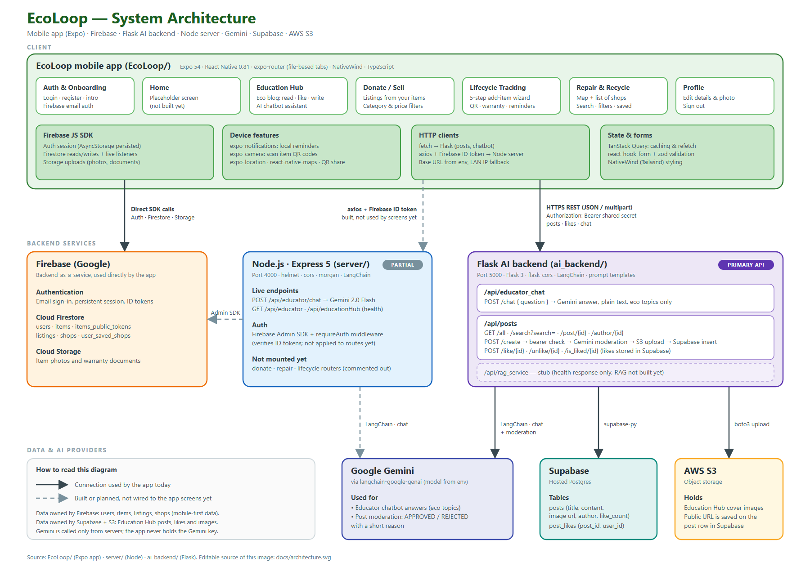
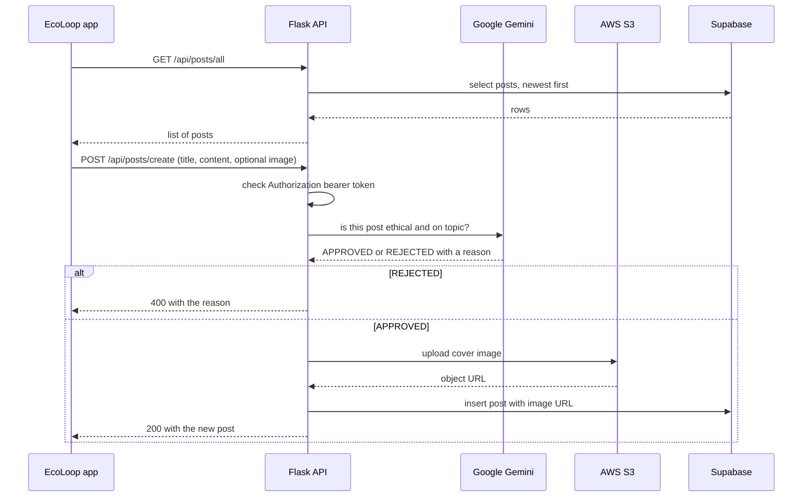
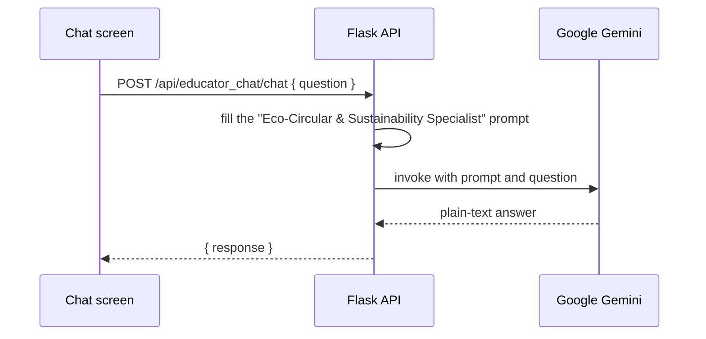
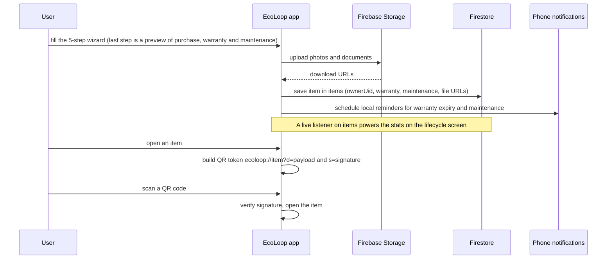

# EcoLoop

EcoLoop is a mobile app that helps people live more sustainably. It combines an eco-education blog with an AI assistant, a marketplace for donating or selling used items, a tracker for the lifecycle of the things you own (warranty, maintenance, QR labels), and a finder for repair and recycling shops.

This repository holds the whole stack:

| Folder | What it is | Tech |
|---|---|---|
| [`EcoLoop/`](EcoLoop) | The mobile app | Expo 54, React Native 0.81, expo-router, NativeWind, TanStack Query, Firebase |
| [`ai_backend/`](ai_backend) | The main REST API: Education Hub posts and the AI chatbot | Flask 3, LangChain, Google Gemini, Supabase, AWS S3 |
| [`server/`](server) | A second API, partly built | Node.js, Express 5, Firebase Admin, LangChain, Gemini |
| [`docs/`](docs) | Architecture diagram and notes | SVG and PNG |

## Architecture



The diagram source is [`docs/architecture.svg`](docs/architecture.svg). To re-export the PNG after editing it, run Chrome headless against the SVG (see [Updating the diagram](#updating-the-diagram)).

## How it works

The app talks to **two kinds of backend**, depending on the feature.

1. **Firebase, directly from the app.** Login, user profiles, items, marketplace listings, repair shops and file uploads all go through the Firebase JS SDK. There is no custom server in between. Firestore security rules are what protect this data.
2. **The Flask API, over HTTP.** The Education Hub (blog posts, likes, search) and the AI chatbot need things the app cannot do safely on its own: calling Gemini with a secret key, moderating text, and uploading images to S3. Those go through Flask.

The Node server exists too. It currently serves one chat endpoint and a health check. Its other routers are written but not mounted, and no app screen calls it yet.

### Feature by feature

| Feature | Screens (under `EcoLoop/app/(app)/(tabs)/`) | Where the data lives | Talks to |
|---|---|---|---|
| Auth and onboarding | `(auth)/login`, `register`, `onboarding` | Firebase Auth, `users` collection | Firebase |
| Education Hub | `education-hub/` (feed, post, author, new post, chat) | Supabase `posts`, `post_likes`; images in S3 | Flask |
| Donate / Sell | `donate-sell/` (browse, new, selling, listing) | Firestore `listings`, `items` | Firebase |
| Lifecycle tracking | `lifecycle/` (list, 5-step add wizard, item, scan, reminders) | Firestore `items`, `items_public_tokens`; files in Firebase Storage | Firebase, device notifications |
| Repair & Recycle | `repair-recycle/` (map and list, search, saved, shop) | Firestore `shops`, `user_saved_shops` | Firebase, device location |
| Profile | `profile/` | Firestore `users`; photo in Firebase Storage | Firebase |
| Home | `home/` | none yet, it is a placeholder screen | none |

### Flow 1: reading and writing Education Hub posts



Likes work the same way: `POST /like/{id}` adds a row to `post_likes` and bumps `posts.like_count`; `unlike` removes the row and lowers the count.

### Flow 2: the AI chatbot



The prompt (`ai_backend/src/prompt_template/educator_chat_prompt_template.py`) keeps the assistant inside its domain: sustainability, circular economy, conservation, climate, green living and related topics. Off-topic questions get a polite redirect. Replies are plain text, no Markdown.

### Flow 3: tracking an item and its reminders



Reminders are scheduled **locally on the phone** with `expo-notifications`, so they do not need a push server. In Expo Go on Android, local scheduling is skipped by design (see `src/services/notification.ts`); use a development build to test them.

### Flow 4: marketplace and repair shops

- **Donate / Sell.** The user picks one of their own `items`, chooses *sell* (with a price) or *donate*, and the app writes a `listings` document with `status: "active"` that points back at the item. The browse screen builds a Firestore query from the category and price filters (`buildListingQuery.ts`).
- **Repair & Recycle.** Shops are read from Firestore. Opening hours are normalised from several shapes and used to show an "open now" state. Distance comes from the phone's location. Results can be shown as a list or on a map, filtered and searched, and saved per user in `user_saved_shops`.

## API reference

### Flask API (`ai_backend`, default port 5000)

| Method and path | Body or query | Success response | Notes |
|---|---|---|---|
| `GET /` | | `200` health message | Also `/api/educator_chat/`, `/api/rag_service/`, `/api/posts/` |
| `POST /api/educator_chat/chat` | `{ "question": "..." }` | `200 { "response": "..." }` | Errors return `500 { "error": "..." }`. Auth check is currently commented out |
| `GET /api/posts/all` | | `200` array of posts | `404` when there are none |
| `GET /api/posts/search` | `?search=<title>` | `200 { "posts": [...] }` | `400` if missing, `404` if no match. Matches the whole title, case-insensitive |
| `GET /api/posts/post/{id}` | | `200 { "post": {...} }` | `404` if not found |
| `GET /api/posts/author/{author_id}` | | `200 { "posts": [...] }` | `404` if none |
| `POST /api/posts/create` | multipart: `post_title`, `post_content`, `post_author`, optional `post_image` | `200 { "message", "post" }` | Needs `Authorization: Bearer <HEADER_AUTHORIZATION>`. `400` if rejected by moderation, `401` if unauthorised, `500` if the image upload fails |
| `POST /api/posts/like/{id}` | `{ "user_id": "..." }` | `200` | |
| `POST /api/posts/unlike/{id}` | `{ "user_id": "..." }` | `200` | |
| `POST /api/posts/is_liked/{id}` | `{ "user_id": "..." }` | `200 { "is_liked": true }` | Returns `400` with `is_liked: false` when not liked |

### Node server (`server`, default port 4000)

| Method and path | Body | Response |
|---|---|---|
| `GET /health` | | `{ "ok": true }` |
| `GET /api/educator` | | `{ "success": true, "message": "Health" }` |
| `POST /api/educator/chat` | `{ "chat_message": "..." }` | `{ "message": "..." }` |
| `GET /api/educationHub` | | health response |

More detail is in [`server/docs/APIdocument.md`](server/docs/APIdocument.md).

## Data model

**Supabase (Postgres), used by Flask**

| Table | Columns used by the code |
|---|---|
| `posts` | `post_id`, `post_title`, `post_content`, `post_image_url`, `post_author`, `like_count`, `created_at` |
| `post_likes` | `post_id`, `user_id` |

**Firestore, used by the app**

| Collection | Holds |
|---|---|
| `users` | Profile: full name, phone, date of birth, address, photo |
| `items` | A user's owned item: `ownerUid`, name, brand, model, category, purchase date, warranty and maintenance settings, image and document URLs |
| `items_public_tokens` | Public records that back item QR codes |
| `listings` | Marketplace entries: `ownerUid`, `itemRef`, `type` (`sell` or `donate`), `price`, `status`, timestamps |
| `shops` | Repair and recycling shops: location, categories, opening hours |
| `user_saved_shops` | Shops a user bookmarked |

## Getting started

You need Node.js 20 or newer, Python 3.11 or newer, an Expo-compatible phone or emulator, and accounts for Firebase, Google AI Studio (Gemini), Supabase and AWS. Check the exact versions your team uses; none are pinned in the repo.

### 1. Flask API

```bash
cd ai_backend
python -m venv .venv
.venv\Scripts\activate
pip install -r requirements.txt
```

Create `ai_backend/.env`:

```bash
FLASK_ENV=development
HOST=0.0.0.0
PORT=5000
GOOGLE_API_KEY=your-gemini-key
GOOGLE_GEMINI_MODEL=your-gemini-model-name
SUPABASE_URL=https://your-project.supabase.co
SUPABASE_ANON_KEY=your-supabase-anon-key
AWS_ACCESS_KEY=your-aws-access-key
AWS_SECRET_KEY=your-aws-secret-key
AWS_REGION=your-region
AWS_POST_IMAGE_BUCKET=your-bucket-name
HEADER_AUTHORIZATION=a-long-random-secret
```

```bash
python application.py
```

`FLASK_ENV=development` matters when you start the file directly: the production config has no `PORT` or `HOST`, so `python application.py` fails without it. For production, run behind a WSGI server (for example `gunicorn application:app`). `requirements.txt` is a full environment dump that includes Windows-only packages such as `pywin32`, so trim it for Linux deployments.

### 2. Node server (optional today)

```bash
cd server
npm install
cp .env.example .env
npm run dev
```

Fill `.env` from [`server/.env.example`](server/.env.example) (`PORT`, `CORS_ORIGIN`, `FB_PROJECT_ID`, `FB_CLIENT_EMAIL`, `FB_PRIVATE_KEY`, `FB_STORAGE_BUCKET`) and also set `GOOGLE_API_KEY`, which the Gemini client reads from the environment.

### 3. Mobile app

```bash
cd EcoLoop
npm install
```

Create `EcoLoop/.env`:

```bash
EXPO_PUBLIC_FIREBASE_API_KEY=...
EXPO_PUBLIC_FIREBASE_AUTH_DOMAIN=...
EXPO_PUBLIC_FIREBASE_PROJECT_ID=...
EXPO_PUBLIC_FIREBASE_STORAGE_BUCKET=...
EXPO_PUBLIC_FIREBASE_MESSAGING_SENDER_ID=...
EXPO_PUBLIC_FIREBASE_APP_ID=...
EXPO_PUBLIC_API_BASE=http://10.0.2.2:4000
EXPO_PUBLIC_QR_SECRET=a-long-random-string
BACKEND_IP_ADDRESS=http://<your-computer-LAN-IP>:5000
```

```bash
npx expo start
```

Then press `a` for an Android emulator, `i` for iOS, or scan the QR code with Expo Go. The phone must reach your computer on the LAN to call the Flask API. Use a development build (`npm run android` or `npm run ios`) to test camera scanning, maps and notifications reliably.

## Project structure

```
.
├── EcoLoop/                      Expo app
│   ├── app/                      Screens (file-based routing)
│   │   ├── (auth)/               login, register, onboarding
│   │   └── (app)/
│   │       ├── (tabs)/           home, education-hub, donate-sell, lifecycle, repair-recycle
│   │       └── profile/
│   └── src/
│       ├── components/           shared and per-feature UI
│       ├── features/             API helpers and hooks per feature
│       ├── services/             Firebase, notifications, storage, axios client
│       ├── hooks/ lib/ providers/ validators/ theme/ types/
│       └── lib/firebase.ts       Firebase app, auth, Firestore, Storage
├── ai_backend/                   Flask API
│   ├── application.py            entry point
│   └── src/
│       ├── router/               educator_chat, posts, rag_service, health
│       ├── ai_actinons/          chat answer and post moderation generators
│       ├── prompt_template/      LangChain prompts
│       ├── database/             Supabase queries for posts and likes
│       ├── configs/              Gemini and Supabase clients
│       └── utils/                S3 upload, bearer check
├── server/                       Node/Express API
│   └── src/                      app, config, middlewares, modules per feature
└── docs/                         architecture.svg, architecture.png
```

## Known issues and next steps

These come from reading the code, and they are the most useful things to fix next.

**Security**
- A bearer token is hardcoded in the app source (`ChatInterface.tsx` and `post/new.tsx`). Anyone who has the app or the repo can read it. Treat it as leaked: change `HEADER_AUTHORIZATION` on the server and stop shipping the secret in the client. The better fix is to send the Firebase ID token and verify it in Flask with the Firebase Admin SDK, as `server/src/middlewares/requireAuth.js` already does.
- `POST /api/educator_chat/chat` has its auth check commented out, so anyone who finds the URL can spend your Gemini quota.
- `like`, `unlike` and `is_liked` trust the `user_id` in the request body. They are not tied to a verified user.
- `EXPO_PUBLIC_QR_SECRET` ships inside the app, and `src/lib/crypto.ts` signs QR payloads with a plain SHA-256 of secret plus payload, not a real HMAC. That is fine for a demo, not for production.

**Bugs**
- `POST /api/posts/create`: `post_author` is only read for multipart requests, so a JSON request crashes with a `NameError`. If Gemini fails, moderation returns `None` and the next line crashes on `.status`.
- `ai_backend/src/database/post_actions.py` defines `like_post` three times, and the like counter is read, add one, write, so simultaneous likes can lose counts.
- Post search uses `ilike` without `%` wildcards, so partial titles do not match.
- `BACKEND_IP_ADDRESS` is not prefixed `EXPO_PUBLIC_`, and Expo only exposes prefixed variables to app code. The app very likely always uses its hardcoded fallback IP (`192.168.43.235:5000`). Rename it and read it in one shared config file instead of in six screens.

**Unfinished**
- The Home tab is a placeholder.
- The Node server mounts only the educator and Education Hub routers. The donate, repair and lifecycle routers are commented out, and `EcoLoop/src/features/lifecycle/api.ts` calls `/lifecycle/items` routes that do not exist yet.
- `/api/rag_service` is a stub, and `EcoLoop/src/features/education-hub/api.ts` is empty.
- The chatbot exists in both servers with different request fields (`chat_message` in Node, `question` in Flask). Pick one.
- Docs drift: `EcoLoop/docs/EducationalHub.md` describes `blog_*` fields, but the code uses `post_*`.

## Updating the diagram

Edit `docs/architecture.svg`, then re-export the PNG (adjust the Chrome path for your machine):

```bash
chrome --headless=new --hide-scrollbars --force-device-scale-factor=1 --window-size=1800,1270 --screenshot=docs/architecture.png file:///ABSOLUTE/PATH/TO/docs/architecture.svg
```

## Author

Buddhika Madusanka
